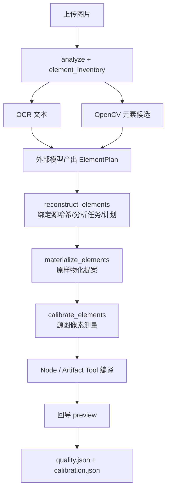

# image2PPT 技术路线与优化空间

更新日期：2026 年 10 月 21 日
适用范围：命令行引擎（image2ppt-core）与服务化重建（image2ppt-vision）两条线。
本文用于讨论"下一步还能优化什么"，所有数字都来自实际运行，不是估算；标"估计"的除外。

---

## 1. 一句话判断

**重建链路已经打通、可测量；瓶颈已从"结构错误"转移到"字体排版与装饰细节"。**

- 服务端能稳定产出原生文字/形状 + 局部栅格，整页差异可量化、可回归。
- 今天修掉两个**结构性错误**（错误声明色、越界框），page05 从 19.51 降到 16.83。
- 但**字体测量在实际容器里 0 次生效**（缺字体），这是目前最大的确定性缺口：不是算法问题，是部署问题。
- 装饰层（渐变细节、波纹、图标）几乎全部丢失，是"看起来像不像"的主要残留。

---

## 2. 系统现状

### 2.1 两套代码，两条路径

| | image2ppt-core | image2ppt-vision |
|---|---|---|
| 位置 | 本机 `D:\Code\image2PPT` / GitHub `image2ppt-core` | 服务器开发副本 / GitHub `image2ppt-vision`（私有） |
| 形态 | Node 编译 + SlideIR + 保真闸门 | FastAPI 服务（Docker） |
| 职责 | IR → PPTX 的确定性编译、能力门、质量探针 | 上传、OCR/OpenCV 证据、ElementPlan 接收、物化、校准、任务编排 |
| IR 能力 | text / shape / image / **table / chart** | 实际只产出 text / shape / image |

两者通过 SlideIR 0.1 对接：服务输出 IR，编译器负责落地与回导。

### 2.2 服务端的 element 链路



关键设计：**物化阶段不修改提案**，所有修正集中在校准阶段，并逐条记录 `before / after / 依据`。这样做的好处是追溯清楚，代价是修正在校准阶段必须拿到足够的源图证据。

### 2.3 旧路径仍在

`reconstruction.py`（含 `table_reconstruction.py`、ModulePlan、多模型监督）保留原契约，但 `reconstruct_elements` 不经过它。结果是：

- 编译器已支持原生表格/图表，**服务端的计划契约还没有 table/chart 节点**；
- ModulePlan / 多模型实验有代码，**没有接入 HTTP**。

---

## 3. 今天完成的三个提交

分支：`fix/source-pixel-colour`（GitHub 已同步）

| 提交 | 问题 | 做法 | 证据 |
|---|---|---|---|
| `26970a4` | 两张主卡片标题栏计划声明为深蓝/深青，源图实为浅色渐变；白标题只在错误深色栏上才看得见 | 填充：掩码后拟合平面（纯色/单轴渐变），偏差超阈值才覆盖；文字：用字形像素测色，分离度不足则拒绝测量 | 交付运行记录 `solid_fills_applied: 0`，修复后同容器为 6 且带偏差记录；整页 19.51 → 17.09 |
| `f02acfa` | 右下角胶囊被声明成 778×78，实际约 270×50，把右下角盖成一块浅蓝，`05` 被遮挡 | 顺着形状声明的边框收紧；要求匹配呈细框状、内部确为声明填充色 | `geometry_tightened: 3`；整页 17.09 → 16.83；`05` 恢复可见 |
| `298306d` | 服务实际调用 `calibrate_fills=False`，上面两项修复在真实管线里根本不执行 | 改为 `True` 并注明原因 | 元素相关测试 36 项通过 |

> 教训（对后续优化同样适用）：**两个错误可能互相抵消**。单独修"栏的颜色"会让白字消失、指标变好而页面更差。任何单属性修正都必须同时验证指标和画面。

---

## 4. 质量现状

### 4.1 page05（同容器、Artifact Tool 2.8.99）

| 版本 | 平均像素差 | >80 差异面积 |
|---|---|---|
| v0.3.0 校准输出（同容器重跑） | 19.51 | 9.48% |
| + 填充与文字颜色 | 17.09 | 6.51% |
| + 边框收紧（当前） | **16.83** | 6.50% |

说明：v0.3.0 交付记录为 21.86，那是服务器/本机字体环境下的数；上表统一在 `image2ppt-vision:0.2.1` 容器内重跑，只用于 A/B 对比，不与交付记录横向比较。

参照：同一页内容作为一张裁剪图时约 3–4。原生重建与裁剪的差距就是"字体 + 装饰"的成本。

### 4.2 结构指标（page05）

- 205 个节点：104 文字 / 81 形状 / 20 图标
- **分组 0**（旧路径能建分组，element 路径写死 `groups: []`）
- 位图只覆盖 **2.0%** 页面
- 字号 **9 档**：6.3 / 6.9 / 7.5 / 8.0 / 9.2 / 10.3 / 11.5 / 12.6 / 21.8（交付运行时字体测量生效后为 13 档；同一页本应只有少数几档）

---

## 5. 优化空间（按收益 / 风险排序）

### P1 字体与排版闭环 —— 剩余收益最大

#### 5.1 渲染—比对—调整闭环（当前完全缺失）

编译后已经产出回导 preview，但**没有任何代码把它和源图比较**；`quality.json` 里的指标只写报告、不影响输出。

建议：新增一轮"编译后校正"——按节点把 preview 与源图对齐，逐节点计算墨迹偏差，只调整该节点的 `bbox` / `size_pt` / 行距，再编译一次，2–3 轮收敛。这是把 16.8 往下拉的唯一系统性手段，且不需要位图兜底。

#### 5.2 字体拟合的阈值与搜索范围

现状（`typography.py`）：

- 字号只试 `estimate + (-1, 0, 1)` 三个整数；
- 接受条件 `dice < .50` 即通过（形状重叠一半就算拟合成功）；
- `family_margin` 算出来了，但从不参与否决。

这三项共同导致"字选对了大概，但大小、字重、字形都不准"。建议：0.25px 步长连续搜索、收紧到 `dice ≥ .85`、`family_margin` 作为否决条件。

#### 5.3 IR 缺少排版字段

服务只写 `align / wrap / bold / size_pt / color`；编译器其实支持 `line_spacing_pt`，而 `insets` 固定 0、`autoFit: none`、无垂直锚点。

结果是：**拟合用 Pillow 的度量，落地用 PowerPoint 的度量**，两者必然不一致。建议补 `line_spacing_pt`、`insets`、垂直锚点，并让校准阶段写这些字段。

#### 5.4 字号聚类

104 行文字各自独立拟合出 13 档字号。应先按视觉角色（标题/正文/注释）聚类，投票选字体族，再把字号吸附到少数几档。单行看起来没问题，整页看起来"不是一个设计"。

#### 5.5 部署：容器里字体测量 0 次生效

实际服务容器内跑同一条管线：

```
typography_applied 0 | color_only 92 | fills 6
```

原因不是代码，是镜像里缺少字体 → `estimate_text` 全部拒绝 → 只剩颜色修正。**这是当前最便宜的一大步**：把字体烘进镜像（或在启动时校验并在缺失时拒绝服务），可以立刻恢复字号/字族测量。

### P2 装饰与背景 —— "像不像"的主要残留

- **渐变**：服务产出的渐变只有两个色标；源图的柔光、横向多段渐变无法表达。
- **波纹/曲线装饰**：page05 底部有明显的装饰波纹，目前完全丢失。
- **图标**：20 个全部栅格，内部不可编辑。

建议顺序：多色标渐变 → 原生曲线/自由形状装饰 → 图标矢量化（SVG 路径 → 形状）。图标矢量化收益有限，放在最后。

### P3 结构语义与契约

- **分组恒为 0**：`materialize_elements` 写死 `groups: []`，编译器与 skill 都支持分组。分组能让用户整块移动卡片。
- **表格/图表未接入**：编译器已支持，服务计划契约还是 `native_shape / raster_asset`。对于"纪检查处表"类页面，这是原生率的直接损失。
- **形状与文字叠放**：旧路径 `_verified_shape` 拒绝与文字相交的形状；新路径允许，但缺少"形状托着文字"的显式校验，容易出现文字压在错误底色上（今天修的就是这一类）。

### P4 测量基座与工程化

- **渲染器校准只覆盖 `dy`**，且要求画布恰好 1672×941、版本匹配、字体哈希匹配、字号在曲线范围内；否则 `applied: false`。`dx` 有字段但从不使用。
- **质量指标不参与决策**：`native_text_ratio`、`region_residual_fraction`、`retained_raster_text` 只写报告。
- **测试环境分层不清**：服务全量 429 passed，但固定有 1 failed / 17 errors，且与本次改动无关：
  - 17 errors：`test_api_evaluation` 的 fixture 需要向上查找 core 工程的 `scripts/compose.mjs`，服务镜像里只有 vision 代码；
  - 1 failed：`test_table_reconstruction` 报 `no installed font for table`——还是缺字体。

  建议把"需要编译器/字体"的测试标记出来单独跑；补齐字体后，这条失败也会自然消失。
- **启用 fills 的回归面**：今天只在 page05 上验证了 `calibrate_fills=True`；需要在 14 页或更多真实页面上回归，确认保守规则不会误伤。

---

## 6. 建议的实施顺序

| 阶段 | 内容 | 预期（估计） | 验证 |
|---|---|---|---|
| **第 1 步** | 镜像内补齐字体 + 恢复字体测量 | 字号/字族首次真正落地 | `typography_applied > 0`；page05 MAE |
| **第 2 步** | 最小版渲染—比对闭环（只调字号与原点） | 单项最大，系统性收敛 | 2–3 轮后 MAE 单调下降；14 页回归 |
| **第 3 步** | IR 补 `line_spacing_pt / insets / 垂直锚点` | 消除"拟合与落地两套度量" | 文本区域墨迹偏差 |
| **第 4 步** | 字号聚类 + 分组恢复 | 整页"像一个设计" | 字号档数、分组数 |
| **第 5 步** | 多色标渐变 + 装饰曲线 | 视觉相似度 | 区域残差 + 人工对照 |
| **第 6 步** | 表格/图表接入 element 契约 | 原生率 | `native_text_ratio`、表格结构校验 |

---

## 7. 统一验证口径（避免"指标变好、页面变差"）

1. **单页回归**：同一容器、同一渲染器版本下的整页平均像素差 + 前景差异面积。
2. **区域指标**：每节点平均误差 + 前景（墨迹）误差，两者分开看。
3. **结构不变量**：不引入整页位图；`human_acceptance: false`、`powerpoint_checked: false` 保持；修正必须记录 `before/after/依据`。
4. **回归集**：page05 单页 + 14 页 deck；改动涉及填充/几何时跑全部。
5. **人工对照**：每次都要看截图，指标只用来排序，不用来验收。

---

## 8. 明确不做

- 整页 / 区域位图兜底（用户已明确只考虑原生重建）。
- 本地脚本调用模型 API（项目原则）。
- 在校准阶段改写提案本身（保持 `submitted-plan` 可复核，只在校准输出上修正）。

---

## 9. 待讨论的问题

1. **字体策略**：当前策略是“保留模型提案、测量只作建议”。是否允许在模型字号明显错误时用测量值直接覆盖？覆盖到什么程度？
2. **同步 vs 异步闭环**：渲染—比对闭环放在服务任务内（任务变长），还是作为独立后处理接口（可反复重跑）？
3. **fills 默认开启**：保守规则在多页上是否足够安全？是否需要按页给出“修正清单”供人工确认。
4. **分组语义**：分组只用于版面操作，还是也要参与质量校验（例如组内元素不得跨出组框）。
5. **表格/图表优先级**：是先把通用字体质量做到位，还是优先覆盖含表格的页面（业务上可能更常见）。
